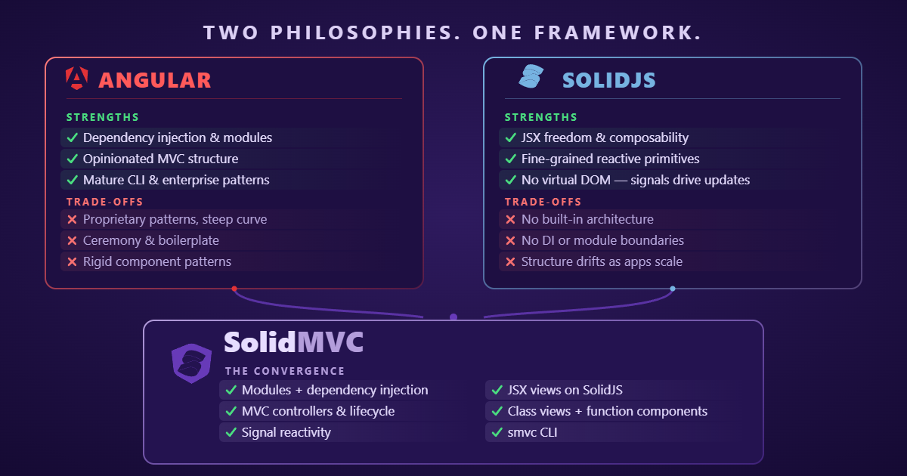

<p align="center">
  <picture>
    <source media="(prefers-color-scheme: dark)" srcset="assets/solidmvc-dark-t.svg" width="380">
    
  </picture>
</p>


[](https://github.com/jwhenry3/solid-mvc/actions/workflows/ci.yml)
[](https://codecov.io/gh/jwhenry3/solid-mvc)
[](https://badge.socket.dev/npm/package/@solid-mvc/core)

# SolidMVC

Angular-inspired architecture on Solid: modules, dependency injection, and
decorators + MVC organization + class-based JSX views + signal reactivity.
Optionally, worker-rendered islands that run views inside Web Workers.
Views render as ordinary Solid JSX, so every Solid library works
unchanged.

<p align="center">
  
</p>

| Package | Role |
|---|---|
| `@solid-mvc/core` | The framework: `View`, `inject()`, `@Module`/`@Component`/`@Injectable`/`@Controller`, signals, `DestroyRef`, router |
| `@solid-mvc/atoll` | Facade over `@atolljs/islands` + `@atolljs/core`: op protocol, proxy DOM, worker runtime, main-thread driver |
| `@solid-mvc/atoll-island` | The `*-island` adapter: `<Island/>`/`islandComponent`/`lazyIsland` on the shell, `viewIslandApp`/`defineViewPolyWorker` on the worker |
| `@solid-mvc/cli` | The `smvc` binary: `new`, `generate`, `serve`/`build`/`test`, `add`, `update` |

## Quick start

```bash
npm install -g @solid-mvc/cli   # the smvc binary
smvc new my-app --islands        # scaffold a routed app (+ worker islands)
cd my-app && smvc serve
```

Or by hand:

```tsx
// main.tsx
import { bootstrap } from '@solid-mvc/core';
import { AppModule } from './app.module';

bootstrap(AppModule, document.getElementById('app')!);
```

```ts
// app.module.ts
import { Module, RouterModule } from '@solid-mvc/core';
import { AppShell } from './app.shell';
import { routes } from './app.routes';
import { API_URL } from './tokens';

@Module({
  imports: [RouterModule.forRoot(routes)],
  providers: [{ provide: API_URL, useValue: 'https://api.example.com' }],
  bootstrap: [AppShell],
})
export class AppModule {}
```

## Views

Views are classes extending `View`. They are never instantiated by Solid:
the JSX runtime module (`@solid-mvc/core/web`) routes each view class through
`createComponent` into a host that constructs it once per mount inside a
fresh child injector, so `inject()` in field initializers resolves against
that view's scope. `render()` runs once; signal reads inside JSX
expressions update the DOM that read them — Solid's fine-grained tracking,
no diff pass. Do not call `setState`/`forceUpdate` (they throw) and do not
use Solid hooks inside `render()`.

```tsx
import { Component, View, signal, computed } from '@solid-mvc/core';

@Component()
export class CounterView extends View {
  count = signal(0);
  doubled = computed(() => this.count.value * 2);

  render() {
    return (
      <section>
        <p>
          Count: {this.count.value} (doubled: {this.doubled.value})
        </p>
        <button onClick={() => (this.count.value -= 1)}>-</button>
        <button onClick={() => (this.count.value += 1)}>+</button>
      </section>
    );
  }
}
```

Props are typed via `View<P>` and available as `this.props` from field
initializers onward. `onInit`/`onDestroy` pair on mount/unmount (implement
`OnInit`/`OnDestroy` for type help).

## Dependency injection

`inject(token)` works inside a class's constructor and field initializers,
only when that class is constructed by the framework (a view mount,
`injector.instantiate`, or `runInInjectionContext`). Tokens resolve up the
injector chain: view scope -> module scopes -> root.

```ts
import { Injectable, InjectionToken } from '@solid-mvc/core';

// App-wide singleton regardless of who injects it.
@Injectable({ providedIn: 'root' })
export class SessionService {
  visits = signal(0);
}

// Value/config tokens for non-class deps.
export const API_URL = new InjectionToken<string>('API_URL');
```

Provider shapes: `MyClass`, `{ provide, useClass }`, `{ provide, useValue }`,
`{ provide, useFactory, deps }`. Register them in `@Module({ providers })`
or `@Component({ providers })`; component-level providers scope to that
view's subtree. `inject(DestroyRef)` gives any class an `onDestroy(fn)`
hook tied to its scope.

## Models and controllers

The MVC split is a convention the DI system supports directly:

- **Model**: an `@Injectable` store owning domain signals, registered on a
  feature module so the scope is the feature.
- **Controller**: a `@Controller` holding view logic (event handlers, draft
  state, lifecycle). Injected by the view.
- **View**: the class above, projecting signals to JSX.

```ts
@Injectable()
export class TodoStore {
  todos = signal<Todo[]>([]);
  remaining = computed(() => this.todos.value.filter((t) => !t.done).length);
}

@Controller()
export class TodoController {
  private store = inject(TodoStore); // resolved from the module scope
  draft = signal('');
  submit() { /* read draft, call store, clear */ }
}
```

Controller lifetime depends on where it is declared:

| Where declared | Lifetime |
|---|---|
| nowhere (`inject(Ctrl)`) | transient, one per injecting scope |
| `@Component({ controllers })` | shared with that view's subtree |
| `@Module({ controllers })` | shared across the module's scope |

## Modules

```ts
@Module({
  imports: [OtherModule],        // transitive providers + visibility
  providers: [TodoStore],        // services registered at this scope
  controllers: [TodoController], // shared controller instances
  components: [TodoView],        // declares ownership: mount requires this scope
  bootstrap: [TodoView],         // view mounted when a route mounts this module
})
export class TodoModule {}
```

`components`/`bootstrap` are an ownership declaration: a declared view may
only mount inside an injector that has that module in scope. Mounting it
elsewhere throws (caught by the view's error boundary). Undeclared views
mount freely; their import binding is their identity.

`@Component({ imports: [SharedModule] })` makes a view standalone: the
module's providers and visibility enter the view's own scope, so a view can
exist outside any declaring module.

## Signals

`signal`, `computed`, `batch`, `untracked` wrap Solid's reactive
primitives while keeping the `.value` surface. `effect` is augmented:
created inside a constructor or field initializer it registers its disposer
on the enclosing scope and dies at `onDestroy`; outside an injection
context you must dispose it yourself. Declare field-initializer effects
*below* the signals they read, since effects run once immediately at
construction.

## Router

```ts
// app.routes.ts
export const routes: Route[] = [
  { path: '/', module: TodoModule },        // mounts the module injector + its bootstrap view
  { path: '/counter', component: CounterView },
  { path: '/hello/:name', component: HelloView }, // :param -> Router.params
  // Nested routes: the parent renders a shell, children swap in its outlet.
  { path: '/settings', component: SettingsShell, children: [
    { path: 'general', component: GeneralView },   // /settings/general
    { path: 'security', component: SecurityView }, // /settings/security
  ]},
  { path: '*', component: () => <p>Not found.</p> },
];
```

```tsx
// Shell: <Link to> for navigation, <RouterOutlet/> for the match.
<Link to="/todos">Todos</Link>
<RouterOutlet />
```

```ts
// Inside a view: navigate + read params off the signal-based Router service.
private router = inject(Router);
this.router.navigate('/counter');
const name = this.router.params.value.name;
```

Routes may carry `component` (any view or function component) or `module`
(its `bootstrap` view renders inside the module's injector). Module routes
are the feature-boundary mechanism: providers and controllers declared on
the module are scoped to everything mounted under that route. `children`
nest by prefix-match: each `<RouterOutlet/>` renders one chain level, so
the parent view stays mounted while children swap; `Router.params` merges
params from every level.

The router owns navigation itself: `navigate()` wraps `pushState`,
`popstate` restores back/forward, and a document-level interceptor claims
same-origin `<a href>` clicks so plain anchors route without a `Link`.
Listeners live on the router's injector scope and detach on destroy.

**Base path**: the router derives its mount prefix from `document.baseURI`
at construction, so the same bundle works at `/` or nested under
`/docs/demo/`. `RouterModule.forRoot(routes, { basePath })` overrides it.

## Function components

Views and plain Solid function components mix freely. Function components
get real Solid semantics (`onMount`, `createMemo`, `useContext`) plus
scope-aware helpers:

```tsx
const theme = useService(ThemeService);      // resolve from the ambient injector
const ctrl = useController(TodoController);  // fresh instance owned by this mount

<Provide providers={[LocalStore]}>
  <Child />
</Provide>                                    // subtree-local providers
```

## The Solid ecosystem, unchanged

`render()` returns ordinary Solid JSX, so anything that works in a Solid
app works here — no adapter packages:

- **Any Solid component or library** drops straight into view JSX —
  icon sets, UI kits, form controls, `<For>`/`<Show>` control flow.
- **Fine-grained by construction**: the framework's signals wrap Solid's
  own reactive graph — updates land on the DOM that read them.
- **Everything else** is two moves — provide the client object through DI
  (`{ provide: QueryClient, useValue: client }`), bridge its `subscribe`
  into a signal bound to the scope's `DestroyRef`. DOM-bound libraries
  (charts, editors, maps) get a small function-component wrapper.

`examples/enterprise/` is the proof: TanStack Query, ECharts, zod,
date-fns, lucide, and a Tailwind/shadcn component layer, all wired
through those moves. The same View classes render inside worker islands
too — the demo's revenue chart is ECharts emitting SVG through the proxy
DOM.

## Islands (worker-rendered views)

`@solid-mvc/atoll-island` renders `View` classes inside a Web Worker
against a proxy DOM (the AtollJS engine under the hood); commits stream
back as ops the driver replays onto real DOM. Three pieces:

**Worker entry** (must stay bundler-detectable):

```ts
// island.worker.ts
import { defineViewPolyWorker } from '@solid-mvc/atoll-island/worker';
import { CounterIsland } from './island-apps';

export const worker = defineViewPolyWorker({
  apps: { counter: CounterIsland },
});
```

**Island apps**: ordinary `View` classes, imported only by the worker.
`@Component`, signals, `inject()`, and lifecycle all work unchanged.
`emit(name, payload)` sends events to the shell's `onEvent` handler.

**Shell side**:

```tsx
import { Island, islandComponent, connectIslandWorker } from '@solid-mvc/atoll-island';
import type { WorkerLike } from '@solid-mvc/atoll-island';

// The literal new URL(..., import.meta.url) is what the bundler detects.
const islandEntry = (): WorkerLike =>
  new Worker(new URL('./island.worker.ts', import.meta.url), { type: 'module' }) as WorkerLike;

const Counter = islandComponent<{ start?: number }>('counter');

// Owns its worker:
<Counter worker={islandEntry} props={{ start: 0 }} onEvent={handle} />

// Or share one worker across islands via a client:
const client = connectIslandWorker({ worker: islandEntry });
<Counter client={client} props={{ start: 40 }} />
<Island client={client} app="clock" />
```

Props and event payloads cross via `postMessage`/`structuredClone` and must
be cloneable; functions cross only via `callbackProp` markers. `lazyIsland`
code-splits the shell binding.

**The contract facade** — for a fully decoupled call site, one shared
module describes the island (app name, prop/event schemas, worker factory)
and both sides consume it:

```ts
// counter.contract.ts — imported by the shell AND the worker entry
import { defineIslandContract, z } from '@solid-mvc/atoll-island';

export const counterContract = defineIslandContract({
  app: 'counter',
  props: z.object({ start: z.number().optional() }),
  worker: () => new Worker(new URL('./island.worker.ts', import.meta.url), { type: 'module' }),
});
```

```tsx
// shell — no worker plumbing; props and events are typed by the contract
const Counter = islandComponent(counterContract);
<Counter start={0} onEvent={(name, payload) => ...} />
```

```ts
// worker entry — attach the same contract for schema-checked props/emits
import { viewIslandApp } from '@solid-mvc/atoll-island/worker';
export const worker = defineViewPolyWorker({
  apps: { counter: viewIslandApp(CounterIsland, { contract: counterContract }) },
});
```

`examples/enterprise/` uses this pattern for its worker-rendered ticker,
and goes further: every routed page is an island app on its OWN worker —
one `<page>.worker.tsx` entry per route, connected lazily through
`PageWorkerHost.clientFor(app)` (see `src/workers/` +
`src/pages/worker-page.tsx`),
the dashboard nests the ticker as a real sub-worker island
(`islandComponent(tickerContract)` inside the worker tree — `mountIsland`
takes the nested path on a ProxyElement target), and the revenue chart is
a sibling worker island rendering echarts' SVG output through the proxy
DOM into a `data-atoll-slot` box.

## Repository layout

```
packages/core/         @solid-mvc/core
packages/atoll/        @solid-mvc/atoll
packages/atoll-island/ @solid-mvc/atoll-island
src/app/               demo app (todos / counter / hello / islands)
examples/enterprise/   separate Vite app consuming the packages by name
docs-consumer/         docs site app
docs/                  architecture notes (framework.md, islands.md)
```

## Commands

```bash
npm install              # root deps + workspace links
npm run dev              # demo dev server on :5173
npm run dev:enterprise   # examples/enterprise dev server
npm test                 # vitest: framework + app + islands suites
npm run typecheck:all    # root + packages + examples
npm run build            # vite build
npm run ci               # typecheck:all + test (what CI runs)
```

See `docs/framework.md` and `docs/islands.md` for the internal architecture
and the islands wire protocol.
